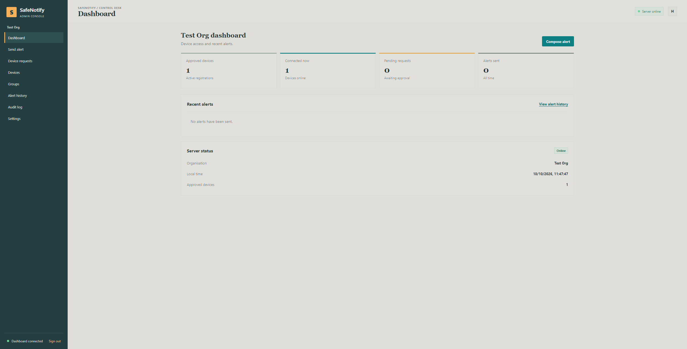
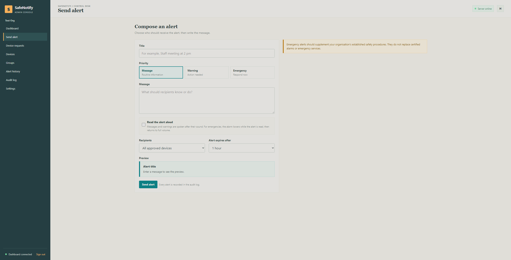
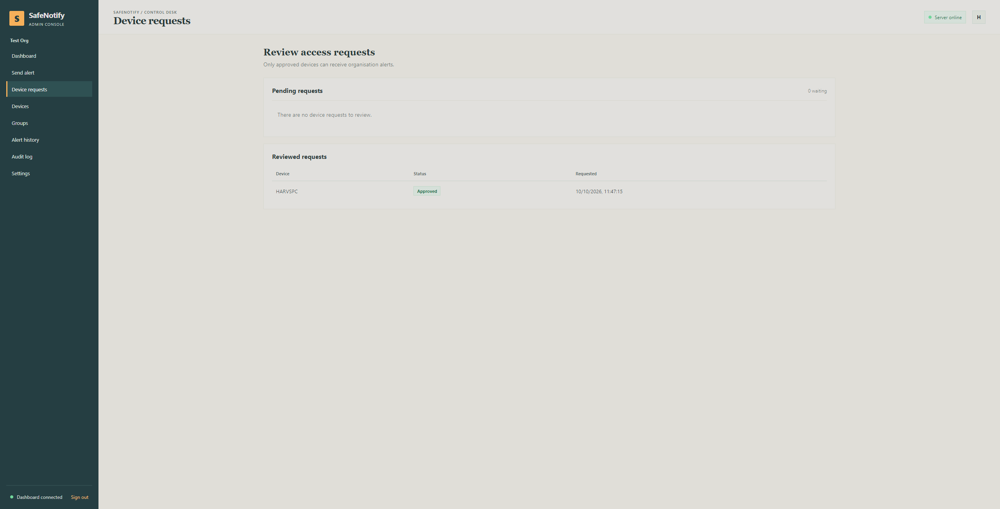
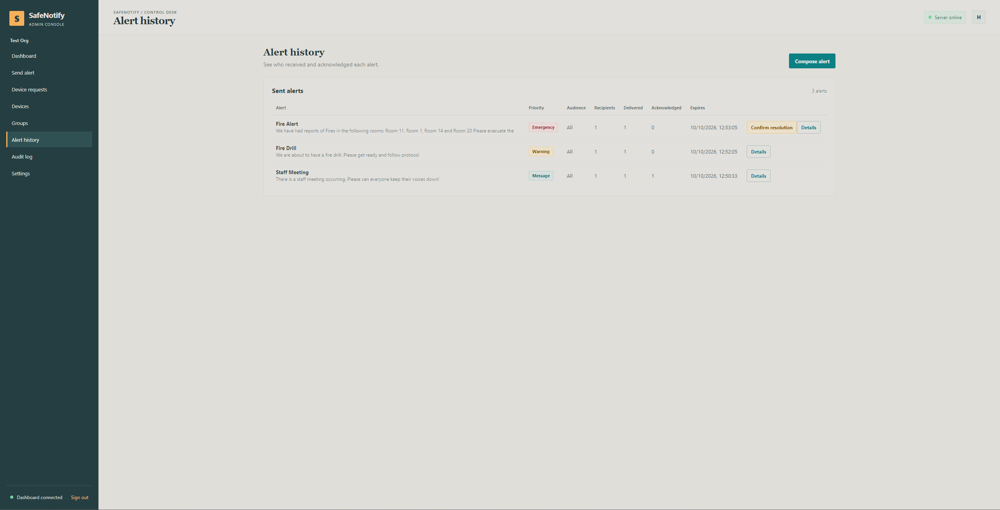
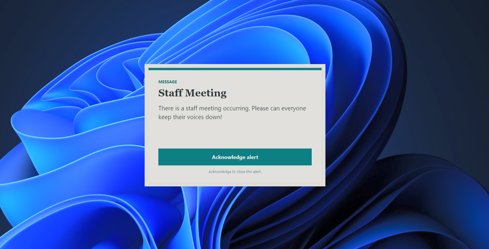
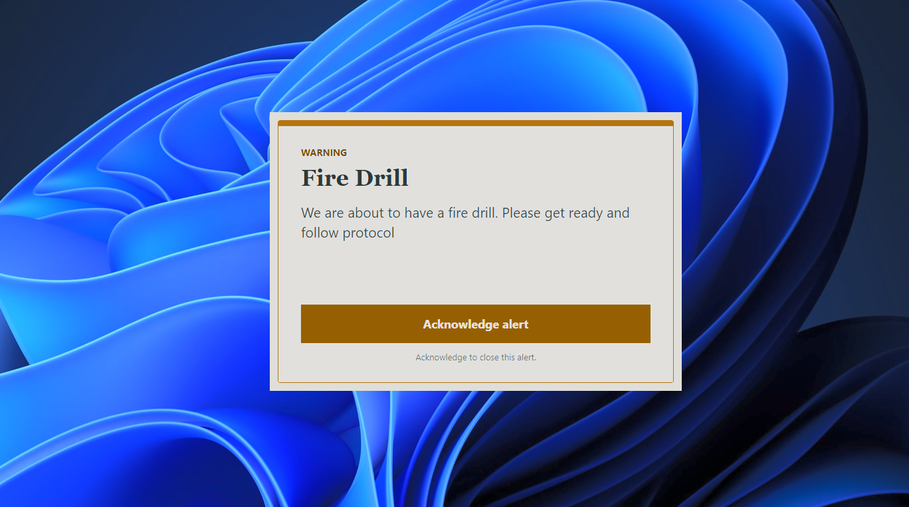
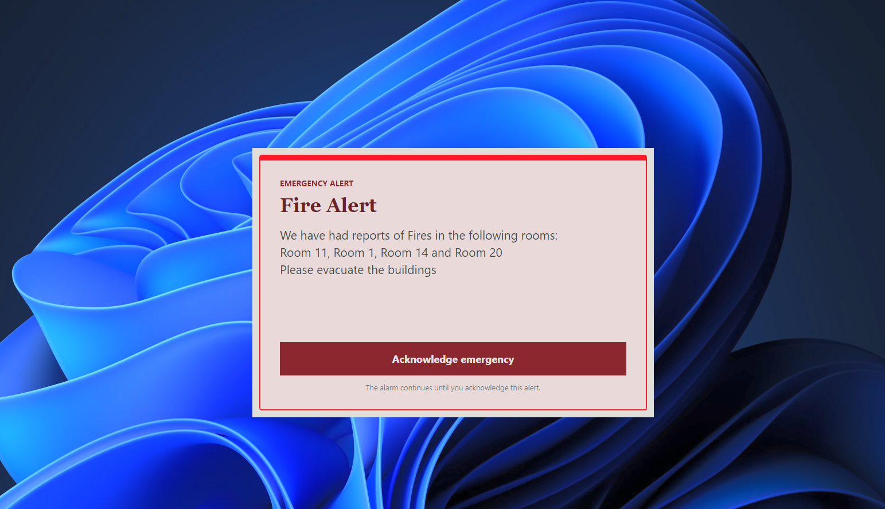

# SafeNotify

[](https://github.com/Dev-HarveyA/SafeNotify/actions/workflows/ci.yml)
[](https://github.com/Dev-HarveyA/SafeNotify/releases/latest)
[](LICENSE)

**A self-hosted alert and messaging system for Windows schools and workplaces.** Administrators manage the organisation from a local dashboard. Approved Windows clients receive messages, warnings, and emergency alerts.

> SafeNotify is an early development project. It has not been certified or independently assessed for life-safety use. Do not use it instead of approved emergency procedures or certified alarm systems.

## Screenshots

### Admin dashboard



### Send an alert



### Device requests



### Alert history



### Alerts on Windows

These examples show how message, warning, and emergency alerts appear on a recipient's screen.







## Download

### [Get the latest Windows installer](https://github.com/Dev-HarveyA/SafeNotify/releases/latest)

Open the latest release, find **Assets**, and download `SafeNotify-Setup-x.y.z-win-x64.exe`. Run the installer and choose **Client and server**, **Client only**, or **Server only**.

If the installer is missing from Assets, check the [release workflow](https://github.com/Dev-HarveyA/SafeNotify/actions/workflows/release.yml). GitHub builds it when a version tag is pushed. Updates are installed by downloading and running the newer installer.

## What is included

- A Windows alert client and self-hosted ASP.NET Core server with a web dashboard.
- Administrator approval for devices, groups, and access to alerts.
- Message, warning, and emergency alerts with acknowledgements and resolution tracking.
- Optional text-to-speech for each alert.
- Local-only server access by default, with optional HTTPS-secured LAN access.
- SQLite storage, audit history, and database backups.

## Install and get started

1. Download and run the installer linked above. It installs for your Windows account and does not need administrator access for the basic setup.
2. Choose which components to install. On the server computer, select **Client and server** or **Server only**. On other computers, select **Client only**.
3. Leave the automatic startup options selected if you want each installed component to start when you sign in. These entries appear in **Task Manager → Startup apps**. The client needs a signed-in Windows session to display alerts.
4. On the server computer, open **Start menu → SafeNotify → SafeNotify Server Dashboard**, or visit [http://127.0.0.1:5080](http://127.0.0.1:5080). On first use, create your organisation and administrator account. Use a password with at least 14 characters.
5. Open the SafeNotify client. Choose **Find organisation**, then **Request to join**. Approve the request from **Device requests** in the dashboard.

If setup finds an earlier SafeNotify installation or server data folder, it asks whether to keep the existing organisation or replace the server data with a blank setup. Replacement removes the database, security keys, and LAN settings from `%LOCALAPPDATA%\SafeNotify\Server`. Logs are kept.

The server runs without a console window. Its program is installed to `%LOCALAPPDATA%\Programs\SafeNotify\server`, and logs are stored in `%LOCALAPPDATA%\SafeNotify\Logs`.

## Use SafeNotify across your LAN

The server listens only on the server computer by default. To allow approved clients on the same Wi-Fi or Ethernet network:

1. On the server computer, open **Dashboard → Settings → LAN access** and select **Set up LAN automatically**.
2. Approve the Windows Firewall prompt. SafeNotify creates HTTPS certificates and limits its firewall rule to the local network.
3. Download the public `SafeNotify-LAN.cer` certificate. On each client computer, drag the file onto the SafeNotify client window. The client installs it for the current Windows user and checks the organisation server again.
4. In the client, use the HTTPS address shown in the dashboard, find the organisation, request to join, and have an administrator approve the device.

Do not expose the dashboard to the internet. The certificate file is public, but never share the server's private key. For a workplace deployment, use a certificate issued by your organisation's certificate authority.

## Data, backups, and uninstall

SafeNotify keeps the server database and data-protection keys under `%LOCALAPPDATA%\SafeNotify\Server`. Keep them together in backups and run the server under the same Windows account that created them. Use **Settings → Database backup** to create a consistent database backup, then copy it and the matching keys to access-controlled storage.

To uninstall, open **Windows Settings → Apps → Installed apps → SafeNotify**, or use **Start menu → SafeNotify → Uninstall SafeNotify**. Uninstalling removes the program but keeps organisation data. To start with a blank organisation, choose the replace option when reinstalling.

## Build from source

Building requires Windows, the .NET 10 SDK, and Inno Setup 6. To build the installer locally:

```powershell
.\scripts\Build-Installer.ps1 -Version 1.0.6
```

The installer is written to `publish\installer\SafeNotify-Setup-1.0.6-win-x64.exe`. Published binaries, installers, local databases, keys, and certificates are excluded from Git.

To run from source for development, open PowerShell in the repository folder. Start the server in one window:

```powershell
powershell.exe -NoProfile -ExecutionPolicy Bypass -File .\scripts\Start-Server.ps1
```

Open a second window and start the client:

```powershell
powershell.exe -NoProfile -ExecutionPolicy Bypass -File .\scripts\Start-Client.ps1
```

Stop the server with **Ctrl+C** in its window. The source server uses `http://127.0.0.1:5080` by default. To move existing source-run data to the installed server, stop the source server and run `.\scripts\Migrate-ExistingData.ps1` once.

Run the build and test checks with:

```powershell
dotnet restore .\SafeNotify.slnx
dotnet build .\SafeNotify.slnx --configuration Release
dotnet test .\SafeNotify.slnx --configuration Release
```

## Repository layout

| Location | Purpose |
| --- | --- |
| `src/SafeNotify.Server` | Server, dashboard, API, and SQLite data model |
| `src/SafeNotify.Client` | Windows client and alert windows |
| `tests/SafeNotify.Server.Tests` | Server workflow tests |
| `scripts` | Development launch, migration, publishing, and installer scripts |
| `config` | Example server configuration |
| `docs` | Architecture notes |
| `.github/workflows` | Continuous integration and release builds |

## Licence

SafeNotify is released under the [MIT License](LICENSE).

Review [SECURITY.md](SECURITY.md) and [docs/architecture.md](docs/architecture.md) before exposing a server to a LAN.
